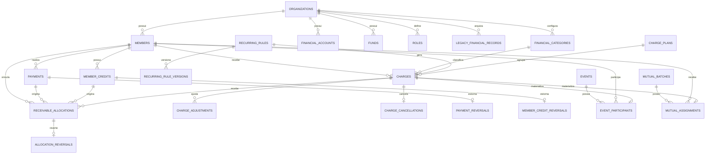

# ERD lógico — núcleo financeiro



## Fonte operacional da verdade

```text
Charge
  + Charge Adjustments
  - Cancellation semantics
          |
          v
Receivable Allocation
          ^
          |
Payment / Member Credit
```

Não existem colunas primárias de:

- saldo do integrante;
- saldo restante da cobrança;
- crédito restante do pagamento;
- saldo atual da conta;
- saldo atual do fundo.


## Reconciliação

A view `v_member_financial_reconciliation` deve produzir:

```text
posição líquida derivada das views
=
último saldo acumulado do extrato
```

Qualquer divergência é tratada como erro de integridade, não como diferença de apresentação.
